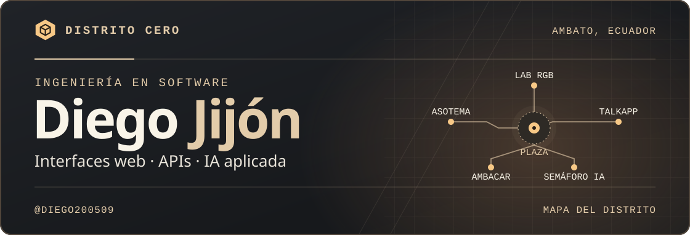
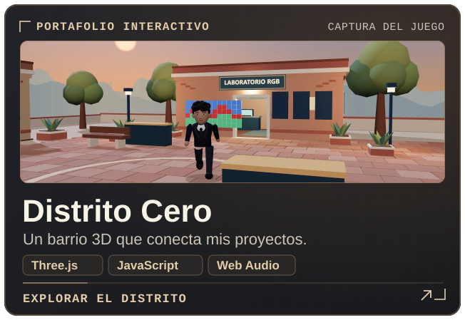
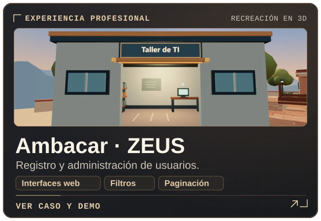
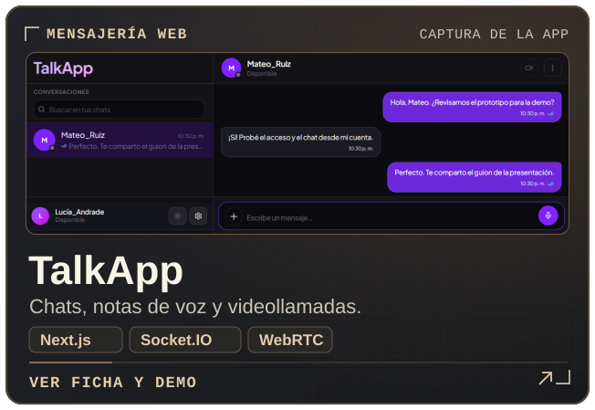
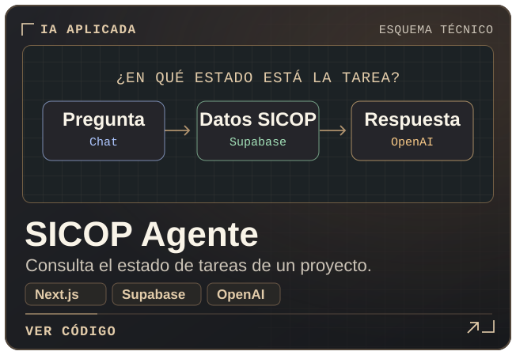
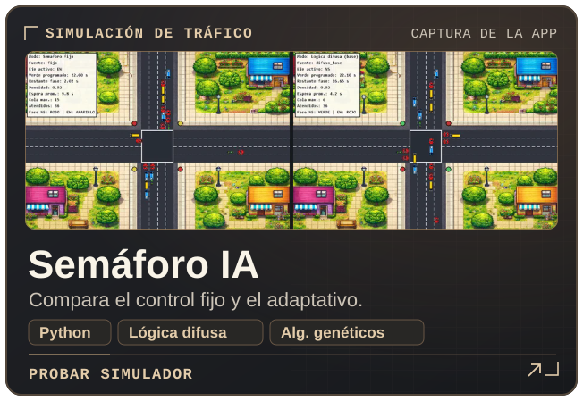
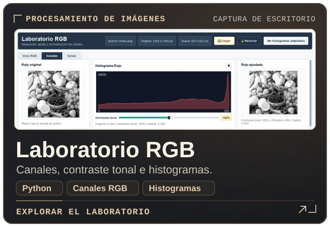
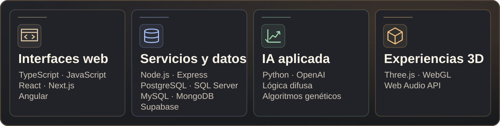
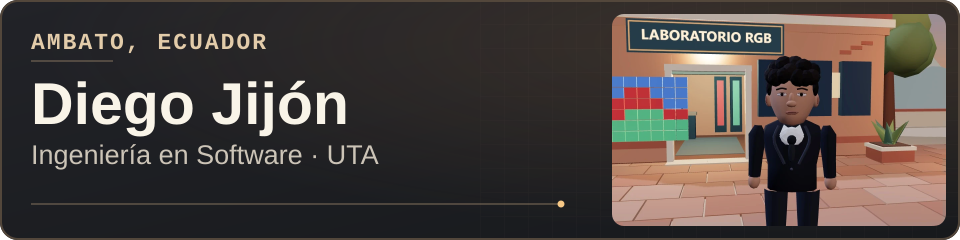

  
  

  <a href="https://diego200509.github.io/?lang=es">
    <picture>
      <source media="(max-width: 600px)" srcset="./assets/diego-jijon-mobile.svg">
      
    </picture>
  </a>

  
  &nbsp;
  

  
  
  
  

  Soy <strong>Diego Jijón</strong>, estudiante de Ingeniería en Software en la <strong>Universidad Técnica de Ambato</strong>. 
  Desarrollo aplicaciones web que conectan interfaces, servicios y datos.

<h2 align="center"></h2>

  
  

  
  

  
  

<strong>Mi aporte en Distrito Cero y Ambacar</strong>

**Distrito Cero.** Desarrollé el barrio con Three.js, integré las demos en la campaña y programé la banda sonora que cambia según lo que ocurre en el juego. [Ver código](https://github.com/Diego200509/diego200509.github.io) · [Probar las demos](https://diego200509.github.io/#projects)

**Ambacar · ZEUS.** Diseñé pantallas para registrar y editar usuarios, conecté las vistas con el backend e implementé filtros y paginación del lado del servidor. La recreación del portafolio muestra el flujo de registro con datos ficticios. [Ver caso y demo](https://diego200509.github.io/#featured)

<strong>Mi aporte en TalkApp y SICOP Agente</strong>

**TalkApp.** Trabajé en los módulos de acceso y chat, incorporé notas de voz y desarrollé la videollamada individual. [Ver código](https://github.com/Diego200509/talk-app)

**SICOP Agente.** Desarrollé un asistente que usa datos de seguimiento del proyecto para responder preguntas sobre el estado de las tareas. [Ver código](https://github.com/Diego200509/sicop-agente)

<strong>Mi aporte en Semáforo IA y Laboratorio RGB</strong>

**Semáforo IA.** Ajusté la medición de colas y el cambio de fase por eje. También incorporé elitismo al algoritmo genético y ajusté su evaluación para penalizar esperas y colas extremas. [Ver código](https://github.com/Diego200509/Semaforo_IA)

**Laboratorio RGB.** Implementé la separación de canales, el cálculo de histogramas y la reconstrucción de imágenes. También añadí una ventana para inspeccionar cada histograma y los cambios de contraste. [Ver código](https://github.com/Diego200509/Lab_imagenes_rgb)

  

<h2 align="center"></h2>

  <picture>
    <source media="(max-width: 690px)" srcset="./assets/mapa-tecnologias-movil.svg">
    
  </picture>

<h2 align="center"></h2>

  

Me gusta trabajar en aplicaciones de principio a fin. En Ambacar trabajé con interfaces y servicios para la administración de usuarios. En mis proyectos también he explorado cómo consultar el avance de una tarea con IA y cómo adaptar un semáforo al tráfico de un cruce.

<h2 align="center"></h2>

  Desde <strong>Ambato, Ecuador</strong>. Abierto a oportunidades remotas y colaboraciones en desarrollo de software.

  
  
  

  

<a href="#inicio">↑ Volver al inicio</a>

