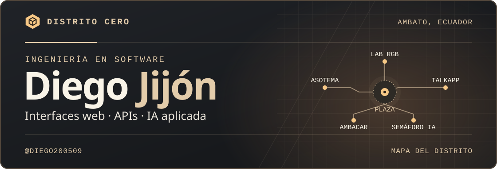
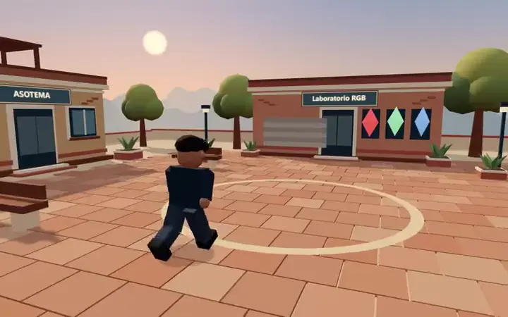
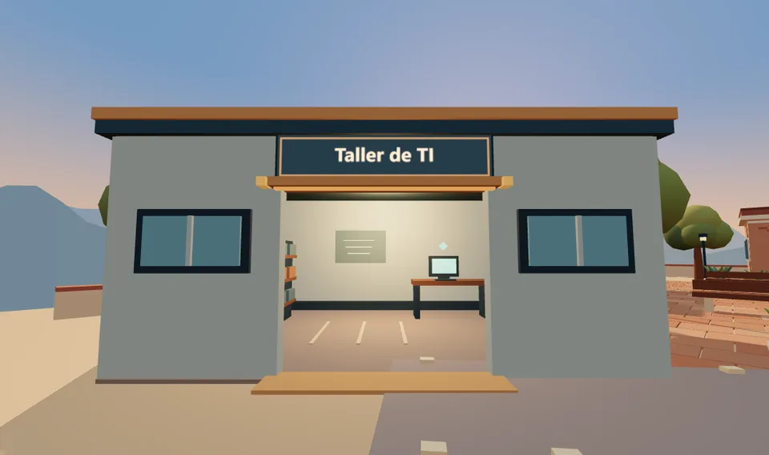

  <a href="https://diego200509.github.io/">
    <picture>
      <source media="(max-width: 600px)" srcset="./assets/diego-jijon-mobile.svg">
      
    </picture>
  </a>

  
  &nbsp;
  

  <a href="#proyectos-destacados">Proyectos</a> ·
  <a href="#tecnologías">Tecnologías</a> ·
  <a href="#contacto">Contacto</a>

Soy **Diego Jijón**, estudiante de Ingeniería en Software en la **Universidad Técnica de Ambato**. Desarrollo aplicaciones web desde la interfaz hasta la API y la base de datos. Me interesa aplicar IA a problemas concretos, como consultar el avance de un proyecto o comparar estrategias de control de tráfico.

## Proyectos destacados

### Distrito Cero · Portafolio interactivo

Un barrio 3D que puedes recorrer para descubrir mis proyectos. Cada estación conecta el recorrido con una demo, desde un cruce de tráfico hasta un laboratorio de procesamiento de imágenes.

**Mi aporte.** Desarrollé el barrio, integré las demos en la campaña y programé la banda sonora que cambia según lo que ocurre en el juego.

**Tecnologías.** Three.js · JavaScript · Web Audio API

[Explorar el distrito](https://diego200509.github.io/) · [Ver las demos](https://diego200509.github.io/#projects) · [Ver código](https://github.com/Diego200509/diego200509.github.io)

### Ambacar · Gestión de usuarios ZEUS

Caso de mis prácticas en el módulo de administración de usuarios de AMBYSOFT.

**Mi aporte.** Diseñé pantallas para registrar y editar usuarios, conecté las vistas con los servicios del backend e implementé filtros y paginación del lado del servidor.

  
Ver el flujo de registro

  
La demo del portafolio muestra cómo se ingresan los datos de un usuario, se asignan la agencia, la división y el rol, y se valida el registro. La simulación usa datos ficticios.

  

[Ver caso y demo de ZEUS](https://diego200509.github.io/#featured)

### TalkApp · Comunicación en tiempo real

Aplicación web que reúne conversaciones individuales, grupos y videollamadas.

**Mi aporte.** Trabajé en la mensajería en tiempo real, que entrega los mensajes mediante Socket.IO y conserva el historial en MongoDB.

**Tecnologías.** Next.js · TypeScript · Express · MongoDB · Socket.IO · WebRTC

[Ver ficha y demo](https://diego200509.github.io/talkapp.html?lang=es) · [Ver código](https://github.com/Diego200509/talk-app)

### SICOP Agente · IA aplicada al seguimiento de proyectos

**Mi aporte.** Desarrollé un asistente que usa datos de seguimiento de SICOP para responder preguntas sobre el estado de las tareas.

**Tecnologías.** Next.js · TypeScript · Supabase · OpenAI

[Ver código](https://github.com/Diego200509/sicop-agente)

[Ver más proyectos](https://diego200509.github.io/archive.html?lang=es) · [Ver todos mis repositorios](https://github.com/Diego200509?tab=repositories)

## Tecnologías

| Área | Herramientas que he usado |
| --- | --- |
| **Interfaces web** | TypeScript, JavaScript, React, Next.js y Angular |
| **Servicios y datos** | Node.js, Express, PostgreSQL, SQL Server, MySQL, MongoDB y Supabase |
| **IA aplicada** | Python, OpenAI, lógica difusa y algoritmos genéticos |
| **Experiencias interactivas** | Three.js, WebGL y Web Audio API |

## Contacto

Desde **Ambato, Ecuador**. Abierto a oportunidades remotas y colaboraciones en desarrollo de software.

[LinkedIn](https://www.linkedin.com/in/diego-jij%C3%B3n-undefined-981508311/) · [Correo](mailto:diegojijon2005@gmail.com) · [CV](https://diego200509.github.io/cv.html?lang=es)
