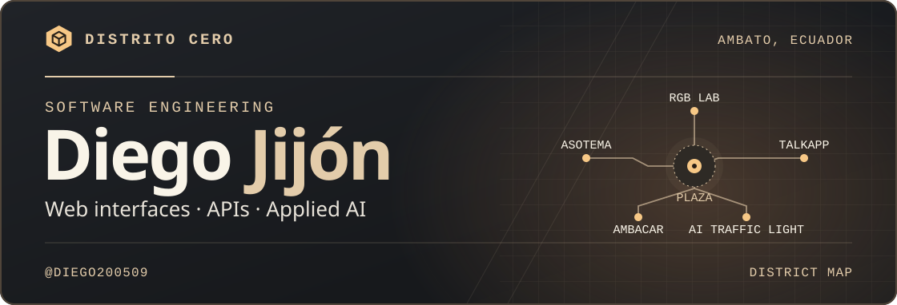
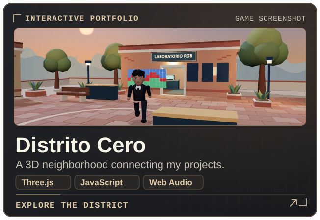
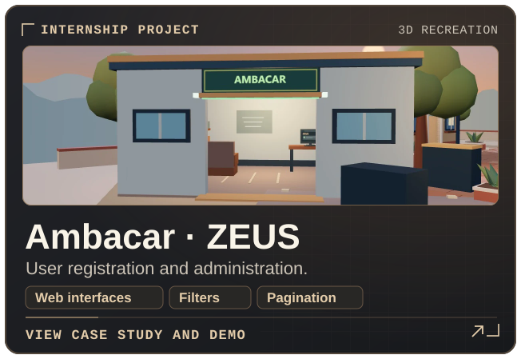
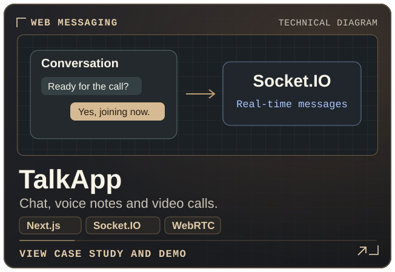
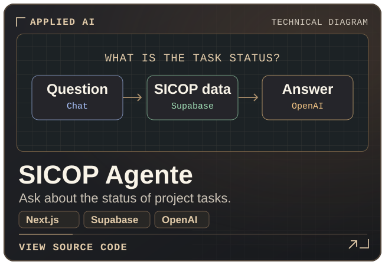
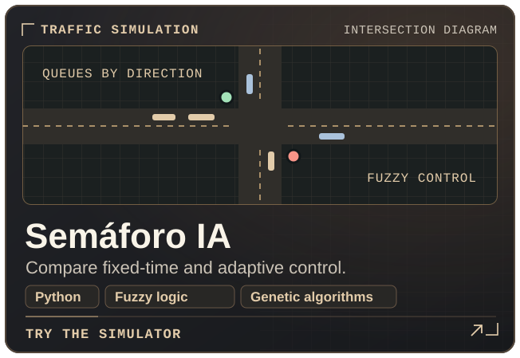
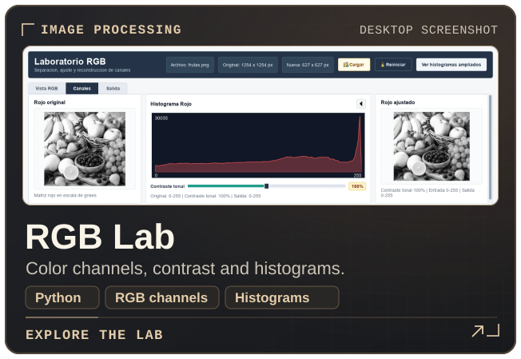
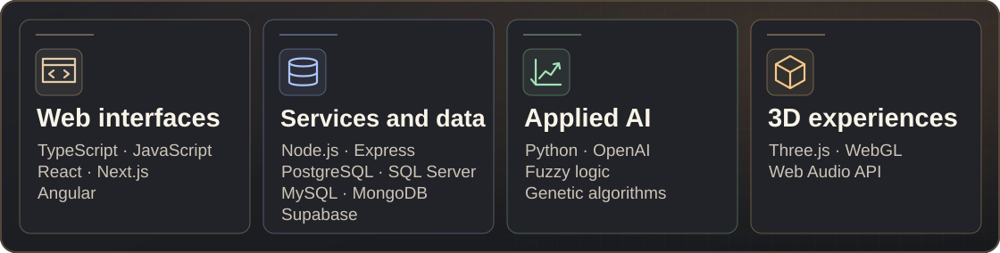
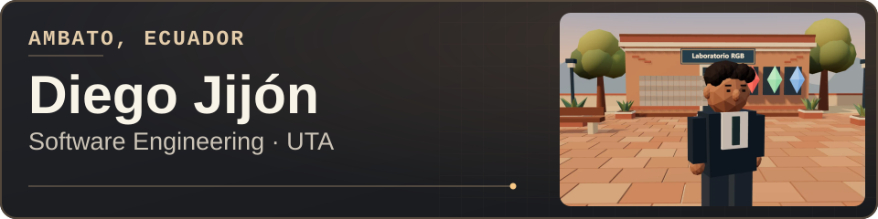

  
  

  <a href="https://diego200509.github.io/?lang=en">
    <picture>
      <source media="(max-width: 600px)" srcset="./assets/en/diego-jijon-mobile.svg">
      
    </picture>
  </a>

  
  &nbsp;
  

  
  
  
  

  I'm <strong>Diego Jijón</strong>, a Software Engineering student at the <strong>Technical University of Ambato</strong>. 
  I build web applications that connect interfaces, services and data.

<h2 align="center"></h2>

  
  

  
  

  
  

<strong>My work on Distrito Cero and Ambacar</strong>

**Distrito Cero.** I built the neighborhood with Three.js, integrated the demos into the campaign and programmed the soundtrack that responds to gameplay. [View source code](https://github.com/Diego200509/diego200509.github.io) · [Try the demos](https://diego200509.github.io/?lang=en#projects)

**Ambacar · ZEUS.** I designed screens for registering and editing users, connected the views to the backend and implemented server-side filtering and pagination. The portfolio recreation demonstrates the registration flow with fictional data. [View the case study and demo](https://diego200509.github.io/?lang=en#featured)

<strong>My work on TalkApp and SICOP Agente</strong>

**TalkApp.** I worked on sign-in and chat, added voice notes and built one-to-one video calling. [View source code](https://github.com/Diego200509/talk-app)

**SICOP Agente.** I developed an assistant that uses project tracking data to answer questions about task status. [View source code](https://github.com/Diego200509/sicop-agente)

<strong>My work on Semáforo IA and RGB Lab</strong>

**Semáforo IA.** I refined how the simulation measures queues and changes signal phases for each direction. I also added elitism to the genetic algorithm and adjusted its fitness function to penalize extreme waiting times and queue lengths. [View source code](https://github.com/Diego200509/Semaforo_IA)

**RGB Lab.** I implemented channel separation, histogram calculation and image reconstruction. I also added a window for inspecting each histogram and the effects of contrast adjustments. [View source code](https://github.com/Diego200509/Lab_imagenes_rgb)

  

<h2 align="center"></h2>

  <picture>
    <source media="(max-width: 690px)" srcset="./assets/en/mapa-tecnologias-movil.svg">
    
  </picture>

<h2 align="center"></h2>

  

I enjoy working on applications end to end. At Ambacar, I worked on interfaces and services for user management. In my projects, I've also explored how AI can answer questions about a task's progress and how a traffic light can adapt to traffic at an intersection.

<h2 align="center"></h2>

  Based in <strong>Ambato, Ecuador</strong>. Open to remote opportunities and software development collaborations.

  
  
  

  

<a href="#top">↑ Back to top</a>

